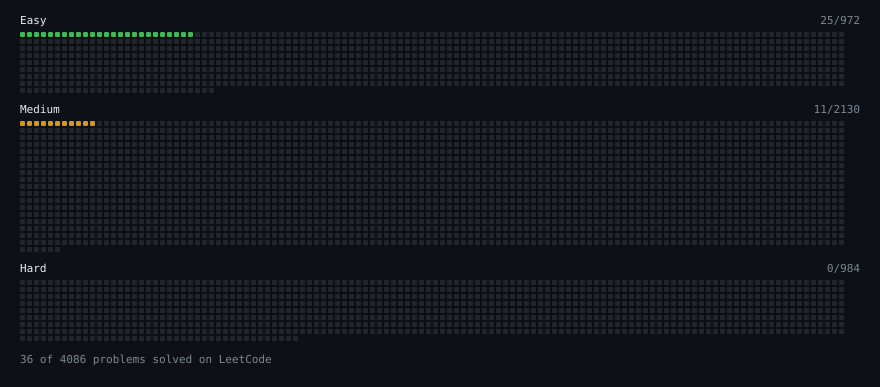

# LeetCode

My algorithms and data structures practice from [LeetCode](https://leetcode.com). Every solution here was written by hand.

**36** solved · 25 Easy · 11 Medium

_Synced nightly at 00:00 MSK via GitHub Actions. Progress and this grid regenerate automatically._

## How I practice

For each problem, I first try to get a correct solution on my own, even if it is not optimal. Then I review the editorial or alternative approaches, reimplement a cleaner or more efficient solution, and compare **time and space complexity** to understand exactly why the optimized approach is better.

## Problems

| Problem | Difficulty | Solved | Solution |
| --- | --- | --- | --- |
| [Container with Most Water](https://leetcode.com/problems/container-with-most-water/) | Medium | 2026-10-19 | [solution](problems/medium/container_with_most_water) |
| [Find Pivot Index](https://leetcode.com/problems/find-pivot-index/) | Easy | 2026-10-19 | [solution](problems/easy/find_pivot_index) |
| [Isomorphic Strings](https://leetcode.com/problems/isomorphic-strings/) | Easy | 2026-10-19 | [solution](problems/easy/isomorphic_strings) |
| [Longest Continuous Increasing Subsequence](https://leetcode.com/problems/longest-continuous-increasing-subsequence/) | Easy | 2026-10-19 | [solution](problems/easy/longest_continuous_increasing_subsequence) |
| [Partition Array into Three Parts with Equal Sum](https://leetcode.com/problems/partition-array-into-three-parts-with-equal-sum/) | Easy | 2026-10-19 | [solution](problems/easy/partition_array_into_three_parts_with_equal_sum) |
| [Ransom Note](https://leetcode.com/problems/ransom-note/) | Easy | 2026-10-19 | [solution](problems/easy/ransom_note) |
| [Remove Duplicates from Sorted Array](https://leetcode.com/problems/remove-duplicates-from-sorted-array/) | Easy | 2026-10-19 | [solution](problems/easy/remove_duplicates_from_sorted_array) |
| [Squares of a Sorted Array](https://leetcode.com/problems/squares-of-a-sorted-array/) | Easy | 2026-10-19 | [solution](problems/easy/squares_of_a_sorted_array) |
| [Valid Anagram](https://leetcode.com/problems/valid-anagram/) | Easy | 2026-10-19 | [solution](problems/easy/valid_anagram) |
| [Matrix Diagonal Sum](https://leetcode.com/problems/matrix-diagonal-sum/) | Easy | 2026-10-14 | [solution](problems/easy/matrix_diagonal_sum) |
| [Transpose Matrix](https://leetcode.com/problems/transpose-matrix/) | Easy | 2026-10-14 | [solution](problems/easy/transpose_matrix) |
| [Add Strings](https://leetcode.com/problems/add-strings/) | Easy | 2026-10-06 | [solution](problems/easy/add_strings) |
| [Add to Array Form of Integer](https://leetcode.com/problems/add-to-array-form-of-integer/) | Easy | 2026-10-06 | [solution](problems/easy/add_to_array_form_of_integer) |
| [Add Two Numbers](https://leetcode.com/problems/add-two-numbers/) | Medium | 2026-10-06 | [solution](problems/medium/add_two_numbers) |
| [Best Time to Buy and Sell Stock](https://leetcode.com/problems/best-time-to-buy-and-sell-stock/) | Easy | 2026-10-06 | [solution](problems/easy/best_time_to_buy_and_sell_stock) |
| [Climbing Stairs](https://leetcode.com/problems/climbing-stairs/) | Easy | 2026-10-06 | [solution](problems/easy/climbing_stairs) |
| [Combination Sum II](https://leetcode.com/problems/combination-sum-ii/) | Medium | 2026-10-06 | [solution](problems/medium/combination_sum_ii) |
| [Contains Duplicate](https://leetcode.com/problems/contains-duplicate/) | Easy | 2026-10-06 | [solution](problems/easy/contains_duplicate) |
| [Generate Parentheses](https://leetcode.com/problems/generate-parentheses/) | Medium | 2026-10-06 | [solution](problems/medium/generate_parentheses) |
| [Group Anagrams](https://leetcode.com/problems/group-anagrams/) | Medium | 2026-10-06 | [solution](problems/medium/group_anagrams) |
| [Kth Largest Element in an Array](https://leetcode.com/problems/kth-largest-element-in-an-array/) | Medium | 2026-10-06 | [solution](problems/medium/kth_largest_element_in_an_array) |
| [Linked List Cycle](https://leetcode.com/problems/linked-list-cycle/) | Easy | 2026-10-06 | [solution](problems/easy/linked_list_cycle) |
| [Maximum Depth of Binary Tree](https://leetcode.com/problems/maximum-depth-of-binary-tree/) | Easy | 2026-10-06 | [solution](problems/easy/maximum_depth_of_binary_tree) |
| [Merge Sorted Array](https://leetcode.com/problems/merge-sorted-array/) | Easy | 2026-10-06 | [solution](problems/easy/merge_sorted_array) |
| [Merge Two Sorted Lists](https://leetcode.com/problems/merge-two-sorted-lists/) | Easy | 2026-10-06 | [solution](problems/easy/merge_two_sorted_lists) |
| [Number of 1 Bits](https://leetcode.com/problems/number-of-1-bits/) | Easy | 2026-10-06 | [solution](problems/easy/number_of_1_bits) |
| [Number of Islands](https://leetcode.com/problems/number-of-islands/) | Medium | 2026-10-06 | [solution](problems/medium/number_of_islands) |
| [Product of Array Except Self](https://leetcode.com/problems/product-of-array-except-self/) | Medium | 2026-10-06 | [solution](problems/medium/product_of_array_except_self) |
| [Remove Nth Node from End of List](https://leetcode.com/problems/remove-nth-node-from-end-of-list/) | Medium | 2026-10-06 | [solution](problems/medium/remove_nth_node_from_end_of_list) |
| [Reverse Bits](https://leetcode.com/problems/reverse-bits/) | Easy | 2026-10-06 | [solution](problems/easy/reverse_bits) |
| [Same Tree](https://leetcode.com/problems/same-tree/) | Easy | 2026-10-06 | [solution](problems/easy/same_tree) |
| [Sum of Subarray Minimums](https://leetcode.com/problems/sum-of-subarray-minimums/) | Medium | 2026-10-06 | [solution](problems/medium/sum_of_subarray_minimums) |
| [Top K Frequent Elements](https://leetcode.com/problems/top-k-frequent-elements/) | Medium | 2026-10-06 | [solution](problems/medium/top_k_frequent_elements) |
| [Two Sum](https://leetcode.com/problems/two-sum/) | Easy | 2026-10-06 | [solution](problems/easy/two_sum) |
| [Valid Palindrome](https://leetcode.com/problems/valid-palindrome/) | Easy | 2026-10-06 | [solution](problems/easy/valid_palindrome) |
| [Valid Parentheses](https://leetcode.com/problems/valid-parentheses/) | Easy | 2026-10-06 | [solution](problems/easy/valid_parentheses) |
